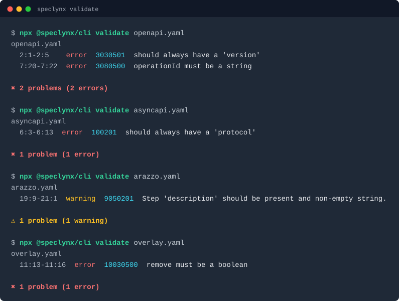

<div align="center">

<h1>SpecLynx</h1>

### One toolchain for every API spec

Parse, validate, transform, and lint **OpenAPI**, **AsyncAPI**, **Arazzo**, **Overlay**, and **JSON Schema** through one shared semantic structure. Local-first and lossless.

<sub>Built by long-time maintainers of Swagger UI and Swagger Editor, OpenAPI Initiative contributors, and AsyncAPI spec maintainers.</sub>

<br/>
<br/>

<p><a href="https://speclynx.com/docs/guides/getting-started/"></a></p>

[](https://editor.speclynx.com)
[](https://github.com/orgs/speclynx/discussions)
[](https://github.com/orgs/speclynx/repositories)

<br/>

<a href="https://speclynx.com">
  
</a>

</div>

<br/>

<div align="center">
  <a href="https://www.openapis.org/"></a>&nbsp;&nbsp;
  <a href="https://www.asyncapi.com/"></a>&nbsp;&nbsp;
  <a href="https://spec.openapis.org/arazzo/latest.html"></a>&nbsp;&nbsp;
  <a href="https://spec.openapis.org/overlay/latest.html"></a>&nbsp;&nbsp;
  <a href="https://json-schema.org/"></a>
</div>

## Get started

Validate any spec from the terminal. Nothing to install, no account:

```sh
npx @speclynx/cli validate openapi.yaml
npx @speclynx/cli validate asyncapi.yaml
npx @speclynx/cli validate arazzo.yaml
npx @speclynx/cli validate overlay.yaml
```



Apply or generate overlays:

```sh
npx @speclynx/cli overlay apply add-contact.yaml openapi-v1.yaml
npx @speclynx/cli overlay diff openapi-v1.yaml openapi-v2.yaml
```


Prefer a UI? Open the [Editor](https://editor.speclynx.com) in your browser, or install the [OpenAPI Toolkit](https://speclynx.com/openapi-toolkit/) for VS Code. More in the [getting started guide](https://speclynx.com/docs/guides/getting-started/).

<a href="https://editor.speclynx.com"></a>

## The tools

SpecLynx combines core tooling, developer workflows, and editing surfaces into one consistent stack, plus a workflow toolkit built on top of it. All of it is open source under Apache 2.0.

| Tool | What it does | Type |
| :--- | :----------- | :--- |
| [**CLI**](https://speclynx.com/cli/) | Validate specs and apply overlays from the terminal and CI. | Command line |
| [**Editor**](https://speclynx.com/editor/) | Write and validate specs in the browser, nothing to install. | Browser editor |
| [**OpenAPI Toolkit**](https://speclynx.com/openapi-toolkit/) | Validation, completion, and preview while you author specs. | VS Code extension |
| [**Language Service**](https://speclynx.com/language-service/) | LSP intelligence for API specs, in any editor or platform. | Integration library |
| [**ApiDOM**](https://speclynx.com/apidom/) | Parse, dereference, and bundle any API spec through one lossless semantic structure. | Core library |
| [**UseArazzo**](https://usearazzo.com) | Validate, run, and trace Arazzo API workflows. Built on SpecLynx. | Workflow toolkit |

## Why SpecLynx is different

Your API specs may be standardized, but the tooling around them rarely is. Every format and version brings its own validator, linter, and converter, and every job brings another script in CI. The result is duplicated logic, checks that disagree, and fragile automation around the contracts your systems depend on.

- **One semantic structure, not five parsers** — every spec is parsed into [ApiDOM](https://speclynx.com/apidom/), one lossless, error-recovering structure with the semantics of each specification layered on top. Tools built on it behave the same way across every supported spec.
- **Local-first, always** — runs on your machine. No accounts, no telemetry, and it works offline. Your specs never leave your environment. [Read the manifesto →](https://speclynx.com/manifesto/)
- **Built by the people who built the ecosystem** — the team behind years of core Swagger, OpenAPI, and AsyncAPI tooling. [Meet the team →](https://speclynx.com/about/)

<p align="left">
  
  
  
  
</p>

## What people say

> Since my days at Apiary and Swagger, I've been looking for OpenAPI tooling I'd actually recommend. SpecLynx is it, and no wonder: it's built by many of the same people. The editor, CLI, and VS Code extension share one engine, so the whole toolchain just makes sense. I'll be using it in my consulting and training.
>
> — **Emmanuel Paraskakis**, Consultant, Trainer, Advisor · Founder, [Level 250](https://www.level250.com/)

> When I started AsyncAPI, the hardest part wasn't the spec. It was the tooling around it: every standard got its own parser, validator and set of quirks. SpecLynx is the toolchain I wish had existed back then, with one consistent model across OpenAPI, AsyncAPI and Arazzo.
>
> — **Fran Mendez**, AsyncAPI author · Building [usecommune.com](https://usecommune.com/)

## Built in the open

SpecLynx is open source under Apache 2.0. Contributions and questions are welcome — star a repo, open an issue, or join the [Discussions](https://github.com/orgs/speclynx/discussions).

## Get help from the maintainers

SpecLynx is free to use. We help developers and teams integrate the tooling, standardize API and workflow specifications, and adopt it across their platform.

- **Website**: https://speclynx.com
- **Email**: info@speclynx.com

---

<div align="center">
  <sub><a href="https://speclynx.com/docs/">Docs</a> · <a href="https://speclynx.com/blog/">Blog</a> · <a href="https://speclynx.com/manifesto/">Manifesto</a> · <a href="https://www.linkedin.com/company/speclynx">LinkedIn</a> · <a href="mailto:info@speclynx.com">Contact</a></sub>
</div>
